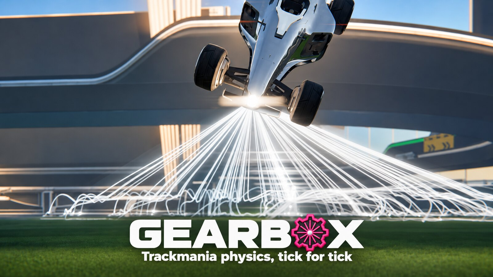

<p align="center"></p>

[](https://github.com/Mergemat/gearbox/releases)
[](LICENSE)

Gearbox simulates a Trackmania 2020 race tick by tick, with the same results
as the game, from a map file and your own game install. On top of that it
searches for faster inputs and gives you an editor to build, inspect and
compare runs.

- **Engine.** Car, collision, water and race rules at 100 ticks per second,
  deterministic, with savestates and forks.
- **World builder.** Builds a race from a `.Map.Gbx` and the game's packs:
  blocks, items, triggers, moving bodies and the four cars.
- **Search.** Finds inputs that reach goals sooner: checkpoints, positions,
  speeds, whole routes.
- **Editor.** A macOS app to drive, scrub, set goals, run searches and compare
  runs against replays and ghosts.
- **GBX.** Reads maps, replays and ghosts, and the game's packs.

## Fair play

Gearbox runs offline. It never touches the game process, and it is not a
tool for leaderboards: runs made with it don't belong on them.

## Install

Download the latest build from
[Releases](https://github.com/Mergemat/gearbox/releases):

- `gearbox-<version>-<platform>`: the command-line tool for macOS, Linux and Windows.
- `Gearbox-<version>-macos-arm64.zip`: the editor for Apple silicon Macs. The
  app isn't notarized: the first time, right-click it and choose **Open**.

You need Trackmania 2020 installed. Gearbox reads its packs; nothing else
from the game.

## Build from source

```sh
git clone https://github.com/Mergemat/gearbox && cd gearbox
cargo run --release -p gearbox-cli -- setup
```

`setup` finds your Trackmania install (Ubisoft Connect, Epic, Steam, Proton
and the usual Wine setups) and remembers it. If it's somewhere else:

```sh
cargo run --release -p gearbox-cli -- setup --game "/path/to/Trackmania"
```

The Rust toolchain version is pinned in `rust-toolchain.toml`; `rustup`
installs it on first build.

## Use

```sh
gearbox map MyMap.Map.Gbx                 # blocks, items and waypoints
gearbox replay MyRun.Replay.Gbx           # replay summary
gearbox replay-inputs MyRun.Replay.Gbx run.txt
gearbox search --window-start 0 --window-end 5000 MyMap.Map.Gbx run.txt out.txt finish
gearbox golden check                      # the engine against the reference traces in tests/golden
```

`gearbox --help` lists every command.

The editor:

```sh
cargo run --release -p gearbox-editor                     # run it
cargo run --release -p gearbox-editor -- bundle --install # install Gearbox.app in ~/Applications
```

## Crates

| Crate | |
|---|---|
| `gearbox-engine` | the physics: car, collision, water, race rules, sessions |
| `gearbox-world` | builds a session from a map and the game's packs |
| `gearbox-gbx` | maps, replays, ghosts and their inputs |
| `gearbox-packs` | the game's packs: blocks, items, materials, cars |
| `gearbox-search` | input search over sessions |
| `gearbox-trace` | reference traces and the per-tick comparison |
| `gearbox-cli` | the `gearbox` command |
| `gearbox-editor` | the editor (macOS) |

## Contributing

See [CONTRIBUTING.md](CONTRIBUTING.md).

## License

[GPL-3.0-or-later](LICENSE). The GBX and pack readers build on
[GBX.NET](https://github.com/BigBang1112/gbx-net) (MIT).

Trackmania is a trademark of Ubisoft Nadeo. Gearbox isn't affiliated with or
endorsed by Ubisoft or Nadeo.
